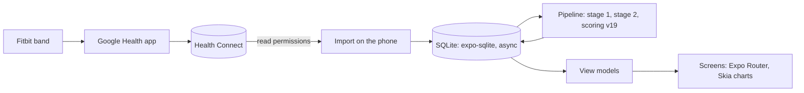

<div align="center">


# Pulse Mobile

**Recovery, strain and sleep from your Fitbit, scored on your Android phone.**

No server, no account, no cloud: Pulse reads your Fitbit data from Health Connect and keeps every byte on the phone.

[](https://github.com/yashsharan0805/pulse-mobile/actions/workflows/ci.yml)
[](https://github.com/yashsharan0805/pulse-mobile/releases)
[](LICENSE)

</div>

## About this fork

This fork of [adityaongit/pulse-mobile](https://github.com/adityaongit/pulse-mobile) includes **Android home screen widgets** and a **live workout recorder** together on `main`. The corresponding upstream contributions are [widgets #32](https://github.com/adityaongit/pulse-mobile/pull/32) and [workouts #38](https://github.com/adityaongit/pulse-mobile/pull/38).

## Download

<div align="center">

<a href="https://github.com/yashsharan0805/pulse-mobile/releases"></a>

Grab the ARM64 APK from this fork’s [releases and test previews](https://github.com/yashsharan0805/pulse-mobile/releases). Published previews identify their included features in the release notes; changes on `main` may be newer than the APK. Previews use a test signing key and cannot update an official app signed with a different key. Sideloading asks you to allow
"Install unknown apps" for whichever app you download it with.

Want it on a server instead, for the browser and several people? See [Pulse](https://github.com/adityaongit/pulse).

</div>

## What you get

- **Sleep, Recovery and Strain** every morning, with a Strain Target for the day
- **Pulse Age**, **Stress** and **Energy Bank** through the day
- **Health Monitor**, **Journal**, **Trends**, **Reports** and **My Dashboard**
- **Small, Medium and Large home screen widgets**, with circular score dials, configurable metrics and heart rate
- **Workout tab** with local session recording, circular heart rate and zones, pause/resume, history and heart-rate charts
- **Ongoing workout notification** with active elapsed time and Pause/Resume/Finish controls

Every score is explained on the [metrics pages](https://pulse.portlabs.in/metrics/).

## Home screen widgets

After onboarding and syncing, open **Settings → App → Home screen widgets**, select a size and confirm Android’s pin request. You can also use your launcher’s **Widgets → Pulse** picker. Use each widget’s **⋮** control to choose its metrics. Selections are saved separately for each instance, and tapping a metric opens its detail screen.

Widgets support light/dark appearance and show sample-data, missing-value and freshness states. They use Pulse’s stored summary and existing sync path. Heart rate is the latest stored reading with its sample time; a widget is not a continuous live sensor monitor. See [widget setup and privacy](docs/widgets.md).

## Record a workout

1. Enable heart-rate sharing on a compatible Bluetooth Low Energy Heart Rate Service sensor and connect it in Pulse.
2. Open the **Workout** tab, choose Walking, Running, Cycling, Strength, HIIT or Other, then start. Allow Bluetooth and notifications when requested.
3. Pause, resume or finish from the tab or ongoing notification. Leaving the page keeps recording owned by the native service. Finish saves the session, observed HR coverage, average/max HR, zones and chart locally.

**Cardio load is a Pulse TRIMP estimate**, which can differ from Fitbit’s value. It needs valid calibration inputs; missing readings, pauses and disconnected time add no estimated load. Workouts do not feed daily scoring. Interrupted recordings require an explicit resume or finish. The existing Strain coach remains available from **Open Strain coach**. See [recording, recovery and storage details](docs/workout-tracker/README.md).

Physical Fitbit Air/BLE compatibility, locked-screen capture/reconnect, OEM battery behavior, long sessions and accessibility still require phone validation. Emulator screenshots use synthetic data and do not establish sensor support. A development-client startup ANR was observed; its cause remains unisolated. Release-build emulator checks completed with slow initial startup.

## Screenshots

Real Android 16 emulator captures from the feature PRs, using **synthetic sample data**, captured on 4 November 2026. These show the individual PR builds rather than a new combined `main` APK.

| Configurable widget | Saved workout |
| --- | --- |
|  |  |

## How it works



On first open, allow every Health Connect permission, including past data: Pulse imports the last 180 days and only ever reads.

## Build from source

```sh
git clone https://github.com/yashsharan0805/pulse-mobile.git && cd pulse-mobile
pnpm install && pnpm android
```

Expo SDK 57 with a development build (Health Connect is a native module, so not Expo Go). [CONTRIBUTING.md](CONTRIBUTING.md) and
[AGENTS.md](AGENTS.md) have the rest; releases are in [docs/releases.md](docs/releases.md).

## License

[PolyForm Noncommercial 1.0.0](LICENSE) · [Security](SECURITY.md) · [Code of Conduct](CODE_OF_CONDUCT.md)

<sub>Pulse Mobile is an independent project, not affiliated with or endorsed by Fitbit, Google, WHOOP, Bevel, Garmin or any other
wearable maker. The code names other products only to cite what they publish.</sub>
