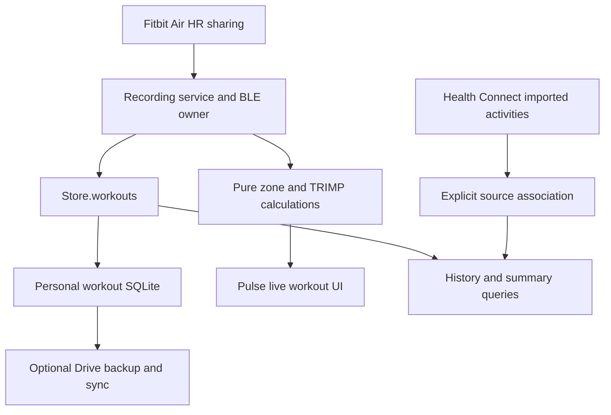

# Pulse: start a workout and record live vitals

Status: implementation preview 0.4.2, Android version code 4, 29 October 2026. The owner replaced the Hevy-style strength-log priority with a Fitbit-style activity recorder. Native recording, pause/resume/finish, sample persistence, estimated load, circular HR UI and personal history are implemented. Physical Fitbit Air and locked-screen validation remain outstanding. [Earlier Hevy findings](hevy-investigation.md) remain research, while sets, reps, routines and exercise libraries are deferred. Optional Google Drive recovery/sync remains a later extension.

## Intended experience

Choose a workout type → connect Fitbit Air heart-rate sharing → Start → watch duration, heart rate, zones and session cardio load → Pause/Resume → Finish → review and save a detailed session. The session continues when the phone is locked or Pulse is in the background. Navigating away does not finish it.

Use Pulse's own UI, including its circular metric components. Show a large live HR/zone display, a separate cardio-load value, elapsed active time and pause/finish controls. The final summary includes an HR timeline, average/max HR, time in zones, active/elapsed duration, load, source and recording coverage. A persistent notification provides return-to-workout and supported controls.

Manual workout types initially cover walk, run, cycling, strength, HIIT and other. These labels classify an activity; strength logging does not require exercise/set entry. GPS, route/pace, auto-detection and workout reminders are later increments rather than prerequisites for the first reliable recorder.

## What can be reused now

These are source observations at fork base `dbda740e683030480cc3336823b257641e1482c6`, not new phone validation:

| Existing code | Reusable capability / gap |
|---|---|
| `src/health/ble.ts` and `bleHr.ts` | Standard Bluetooth Heart Rate Service, scan/connect/retry and HR/RR parsing. The current controller deliberately releases the link after 30 seconds in the background. |
| `src/live/useCapture.ts` | Captures received HR and optional RR intervals while active, currently in a React ref. |
| `src/screens/workout/LiveWorkoutScreen.tsx` | Start/end flow, elapsed time, HR zone, coach and live session/day Strain. Active state belongs to the component and unmount currently finishes/saves a summary. |
| `src/live/liveStrain.ts` | Live zone-weighted Strain accumulation; this is distinct from TRIMP and must not simply be relabeled cardio load. |
| `src/core/engine/strain.ts:trimp` | Pure Banister TRIMP function already used for imported activities by `src/pipeline/stage1.ts`. |
| `src/core/engine/strain.ts:loadStep` | Existing daily ATL/CTL load trend. Keep it distinct from one session's accumulated TRIMP. |
| `src/live/sessions.ts` and `storage.ts` | Basic HR/Strain summaries, capped at 50; no durable HR trace/draft, and storage suppresses write errors. Replace this as the authoritative workout record. |

The engine already provides useful building blocks. Reliable recording and background ownership are the main implementation work.

## Fitbit Air and metric boundaries

Google documents Fitbit Air heart-rate sharing with compatible Bluetooth Heart Rate Profile apps. Enable it through Google Health → Connections → Fitbit Air → Share heart rate. This establishes a supported integration route, not proof that Pulse connects reliably on this particular phone/firmware. The first implementation gate is a real Fitbit Air connection/reconnection check. [Official sharing guide](https://support.google.com/googlehealth/answer/14236705?hl=en).

Starting a Pulse workout creates a Pulse recording session. Remote control of Fitbit firmware workout mode or Google Health's proprietary workout session has not been established. The shared HR stream supplies the measurements for Pulse's own recorder.

| Metric | Initial behavior |
|---|---|
| Live HR, average/max HR | From actually received valid HR samples; stale/disconnected states visible. Average is weighted by observed time. |
| Zones and zone time | Pulse's documented zone policy, with the selected max-HR source and gaps visible. Fitbit zone boundaries need not match. |
| Session cardio load | Pulse's TRIMP-based estimate from observed HR segments, valid resting/max HR and required profile parameters. Show unavailable/provisional with a reason when inputs are insufficient. |
| Session/day Strain | Existing Pulse estimate, shown separately if useful; no metric rename or silent formula change. |
| RR / live HRV | Optional only when the connected device actually emits enough valid RR intervals. HR alone cannot establish beat-to-beat HRV. |
| SpO2, skin temperature, respiratory rate, ECG | No established live input through the HR-sharing path. Do not display a historical Health Connect value as a current workout vital. |
| Calories, distance, pace | Show only from a supported source, or a separately labeled and validated estimate. GPS recording needs its own permission/battery design. |

Google describes its cardio load as TRIMP-based and personalized. Its help page does not establish the full numerical algorithm or parity with Pulse. Label the new value **Cardio load — Pulse estimate**, explain its inputs and retain an algorithm version. Fitbit's all-day load/weekly target and Pulse's existing daily load trend are separate from the single session's value. [Google's load explanation](https://support.google.com/googlehealth/answer/15402655?hl=en).

## Recording architecture

Move session ownership out of the screen into a recording service/controller. An Android foreground recording component owns background BLE capture and durable sample checkpoints; React renders its state. Evaluate `connectedDevice` foreground service/companion-device options against actual permissions, Expo SDK 57 and target Android versions. Android documents service and process-lifetime restrictions for background BLE. [Background BLE guidance](https://developer.android.com/develop/connectivity/bluetooth/ble/background).

Use a dedicated personal workout database under `src/data`, exposed through a Store capability with a memory implementation for tests. Health reimports and demo/source switches must never erase it. Read the required halo reference before changing shared health/data/query code; the configured reference checkout was unavailable during the Hevy planning pass and must be resolved before implementation. Native behavior belongs in an Expo module/config plugin, not hand-edited generated `android/`.

Persist stable session ID, workout type, status, revision, start/end instants, pause events, timezone, sensor provenance, validated timestamped samples, interruption/gap markers, profile/baseline snapshot, calculation version, derived summary and optional imported-activity association. The native recorder needs a bounded durable capture journal for periods when React's JS runtime cannot drain samples; an in-memory bridge queue is insufficient. The data-layer writer ingests journal chunks idempotently through Store and acknowledges them only after its transaction commits. The recording component must not bypass the Store boundary with independent SQL. Choose and document the journal/checkpoint interval and maximum possible unacknowledged sample loss. Save start/pause/resume/finish transitions immediately and recover their ordering with the journal on restart.

State transitions: preparing → recording ↔ paused → finishing → completed; discard and interrupted recovery are explicit. Finish is idempotent and transactional. Resume an interrupted session with a marked gap or save it as interrupted; never manufacture samples while the process was dead. A user force-stop cannot be promised to continue recording.

### Calculation and data-quality rules

- Derive active time from persisted timing events; wall-clock elapsed time includes pauses. Use monotonic timing during a process lifetime and stored instants for recovery, handling clock changes explicitly.
- Integrate only validated, chronologically ordered observed segments. Define a maximum creditable sample gap; do not extend a stale HR across a disconnect or pause. Start a fresh segment on reconnect/resume.
- Validate max HR > resting HR and positive finite inputs before calling existing math. Do not let a numerical fallback zero stand for missing measurements. Required profile/calibration values need explicit provenance; no silent defaults for a purported measured load.
- Capture the calculation inputs at session start so later profile changes do not silently rewrite saved results. Mark estimated HR limits and insufficient coverage; show observed versus active duration.
- Persist raw valid measurements and quality markers so the final summary can be recomputed from the same versioned rules used live. Do not invent a tail interval beyond the last supported observation.
- Keep historical pipeline behavior unchanged initially. Any later change to stored scoring requires the repository's scoring/import version rules and golden tests.

## Health Connect and duplicate handling

The first release saves a local personal workout and its live estimate. Existing daily scores continue using their established Health Connect input path; the live estimate does not automatically change historical pipeline inputs.

After Google Health syncs an activity, offer a time/type/source match and combine its display with the local session. An ambiguous overlap needs confirmation. Preserve both provenance records, use one canonical workout in combined history, and never add both HR streams into a load calculation for the same interval. Imported deletion/reimport must not delete local recording history.

Do not assume that receiving shared HR causes Google Health to create a matching exercise record. An unmatched local session remains a valid saved workout. Showing local sessions in daily load is a later, explicit integration step: define local/imported precedence, overlap accounting and recomputation before enabling it. Health Connect remains read-only throughout.

## Delivery plan

| Phase | Deliverable and gate |
|---|---|
| 0 — Connection proof | Check current HR sharing on the owner's Fitbit Air, rate/fields, permissions, reconnection and coexistence with Google Health. Resolve halo reference and choose the native background-capture design. |
| 1 — Reliable recorder | Workout type, start/pause/resume/finish, native recording ownership, durable drafts/samples, locked-screen notification, interruption recovery and local history. Logging must not depend on health-source onboarding being complete. |
| 2 — Live metrics and UI | Circular HR/zone UI, timeline, observed coverage, average/max HR, zones and explicitly estimated session TRIMP alongside existing Strain. Same input replay produces the same live/final metrics. |
| 3 — Integration and release | Source association/deduplication, existing-history migration, accessible/i18n UI, long-workout/battery checks, and owner phone validation. Old 50-item coach summaries migrate as legacy summaries without invented HR traces. |
| 4 — Optional extensions | Drive backup/restore then device sync; GPS/pace, HR recovery, broader vitals or daily-load integration each needs its own supported source and acceptance checks. |

Meaningful tests cover pause/disconnect gaps, out-of-order/duplicate samples, impossible values, missing calibration, clock changes, crash/checkpoint recovery, full disk/write failure, double Finish, source reimports/demo switches and local/imported overlaps. Compare metric replay against the existing pure TRIMP implementation and preserve existing engine golden values.

The owner checks Fitbit Air pairing/reconnection, locking the screen, switching apps, Bluetooth toggles, notification permission behavior, long recordings and battery use on the phone. The repository disallows local device automation/e2e; Node tests do not establish hardware or background recording reliability. Recording a workout does not imply that every “vital” is exposed by the band.

No Fitbit APK or firmware was reverse engineered in this revision. Feasibility is based on current Pulse source and official integration documentation, with the physical-device gate above still open.

## Preview operation and validation

Open More → Live workout, or use Start workout from onboarding. Enable Share heart rate in Google Health, find/connect the sensor, select an activity and start. Pause closes the HR segment; resume/reconnect opens a new one. Finish saves a session summary and HR timeline. Closing the page keeps recording. The ongoing Android notification opens the recorder and has pause/resume/finish controls. Older coach summaries remain under Open Strain coach.

Missing resting HR/profile calibration leaves load unavailable, while HR recording works. A live estimate updates from durable five-second sample checkpoints; current HR is displayed independently. The last in-flight checkpoint can be lost in a process/power interruption; recovered sessions show Interrupted and require resume or finish. Neither missing HR nor a pause earns load. Data stays in a separate personal database during demo switches and Health Connect reimports. Full Settings reset uses a recoverable native reset marker and clears personal recordings; it refuses while a workout is active.

This preview keeps local workouts separate from Health Connect's imported Activities and daily scoring. Automatic local/imported association, GPS/pace, additional vitals, Drive backup/sync and broader daily-load integration remain planned. No Health Connect write permission or Google authorization was added. Legacy summaries remain accessible rather than synthesizing missing traces.

Owner acceptance checks before a public release:

- [ ] Fitbit Air sharing, first connection and reconnect after another app uses the sensor.
- [ ] A workout with the screen locked and Pulse in the background; verify coverage and a nonempty saved HR trace.
- [ ] Pause/resume from both screen and notification; paused/disconnected time adds no load.
- [ ] Bluetooth off/on, out-of-range recovery and a stopped/force-stopped process; recover without a fabricated continuous trace.
- [ ] Notification permission denial, long-session battery use, large fonts and TalkBack.
- [ ] Installing this fork preview over Widgets Preview 2 keeps prior data and widgets.

## Optional Google Drive backup and device sync

This remains a proposed later extension requested by the fork owner. It is not already implemented in Pulse. The current `AGENTS.md` says no Google sign-in/no network source. The implementation PR must explicitly document the scoped exception for optional Drive authorization/storage; Health Connect remains the sole health-import source and keeps read-only permissions. A Google account is needed only to enable Drive, never to start a workout. No Pulse account/server is required.

### Provider and authorization

Use Drive's private `appDataFolder` with the narrow `drive.appdata` scope for managed backups/sync. Google documents that this space is app-only, hidden in the normal Drive UI and unavailable for sharing or trashing; deletions must be deliberate. Keep a separate manual export path for a user-visible backup. If that export is written directly to ordinary Drive, request the separate `drive.file` scope only for that feature. [App storage](https://developers.google.com/workspace/drive/api/guides/appdata), [scope definitions](https://developers.google.com/workspace/drive/api/guides/api-specific-auth).

For Android, evaluate Google's supported `AuthorizationClient` through an SDK-57-compatible native adapter/config plugin. The Google Cloud project needs Drive enabled, consent configuration and OAuth Android clients matching the actual application ID and signing certificates. Request authorization when the user selects “Connect Google Drive.” Obtain/re-obtain short-lived access through the native authorization API; do not embed a client secret or copy desktop OAuth/refresh-token flows into Android. [Android authorization guidance](https://developer.android.com/identity/authorization). Pin the implementation choice after reading current Expo documentation; no native dependency has been selected here.

Bind each local sync vault, outbox and cursor to the authorized Drive account and a random vault ID. Account switching must offer an explicit restore/new-vault choice; it must never upload the previous account's pending history to another account automatically. Disconnect removes authorization/cached credentials and pauses uploads while keeping local workouts. Deleting remote backups is a separate explicit action.

### First delivery: recoverable backups

1. Create a consistent, versioned logical export through `Store.workouts`, including sensor/calculation metadata, preferences, deletion metadata and an optional active-draft snapshot. Do not copy a live SQLite main file while ignoring its WAL.
2. Write a new immutable backup with schema version, vault/device IDs, creation instant, content hash, record counts and a unique backup ID. Retain several successful generations. Upload retries must preserve the backup ID and tolerate an uncertain previous response.
3. Validate the uploaded artifact before reporting success. Show last successful backup, pending work and errors. A local Save succeeds independently of a network upload.
4. Restore into a temporary validated store, check schema/hash/counts, show a summary, preserve a rollback backup, then explicitly replace or merge the local personal workout vault. Drive sign-in alone never authorizes overwriting local history.

Recommended cloud format: authenticated encryption using a reviewed implementation, with a device-keystore copy of the vault key and a user-held recovery secret for a new phone. A new install needs that recovery secret as well as Drive access; do not claim Google authorization alone restores an encrypted backup. Choose and test the recovery/key-wrapping design before encrypted backup is enabled. Tokens and recovery secrets never appear in logs or exported plaintext metadata.

These backups provide recovery on another phone. Automatic reconciliation of two independently edited histories is the next delivery, with its own tests.

### Second delivery: device sync protocol

**Proposed protocol:** synchronize logical revisions, never overwrite a shared live SQLite database or a single whole-history JSON file. Initially sync completed workout sessions and recording preferences. An active draft is device-owned; live editing/handoff between two phones is deferred. Restoration of a draft from a backup is an explicit recovery action.

Each local mutation and its outbox record commit in one transaction. A revision has a stable operation ID, entity ID, device ID, per-device sequence and parent revision IDs. Use immutable remote revision files; a repeated upload may create duplicate Drive files, but applying the same operation ID is idempotent. Drive file names are not a uniqueness or locking mechanism.

For a workout, use the session aggregate as the merge/conflict unit initially; its sample chunks and timing events retain stable IDs internally. Changes to different workout/settings entities can merge automatically. Divergent children of the same revision, including an edit concurrent with a deletion, retain both branches and show a conflict review. The user can compare/select a revision or keep a separate copy with a new ID. Never discard a session because one phone's clock is later. A user resolution references all conflicting parents.

Represent deletion as a tombstone revision so offline devices cannot resurrect removed workouts. Keep remote transport-file removal separate from a user deleting a workout. In the first protocol version, do not automatically garbage-collect revision/tombstone history; later compaction requires a tested checkpoint and device-acknowledgment/retirement policy. Full reset must offer local-only reset versus explicit deletion of the remote vault, otherwise a reconnect can restore what appeared deleted.

Bootstrap from a validated checkpoint plus revision files. Use the [Drive changes feed](https://developers.google.com/workspace/drive/api/guides/manage-changes) for later discovery; acquire the initial cursor before the initial scan so concurrent changes can be replayed. Apply changes idempotently, process every page and persist the cursor only after corresponding local transactions succeed. A missing/rejected checkpoint or cursor triggers a safe rescan, not an empty-history overwrite. A Drive change is a file event; Pulse still owns entity merge semantics.

Sync on app foreground, after a completed-workout edit/save and via “Sync now”; add best-effort Android background work after phone validation. Google Drive's [push mechanism](https://developers.google.com/workspace/drive/api/guides/push) requires an HTTPS webhook receiver, so the server-free design does not promise instant push sync. Use bounded retries/backoff for transient errors, visible quota/auth errors and resumable uploads where appropriate. [Uploads](https://developers.google.com/workspace/drive/api/guides/manage-uploads), [errors](https://developers.google.com/workspace/drive/api/guides/handle-errors).

### Data scope and release gate

The initial cloud scope is the personal workout vault, including its explicitly recorded session HR trace, quality markers and calculation context. Raw Health Connect records, intraday HR streams, recovery/Strain score databases, chat history and unrelated profile data are excluded. On another phone, health permissions/imports remain device-local; external activity associations must be revalidated, not assumed portable. Any later backup of wider Pulse data needs its own data/schema/recovery design.

Release tests must cover two offline devices editing/deleting the same session, duplicate/uncertain uploads, out-of-order files, interrupted pagination, failed cursor commits, old-client schemas, account switches, token revocation, full Drive storage, encrypted-key recovery and remote data deletion. Unit/integration fixtures simulate these cases; the owner verifies actual authorization/restore on two installations. “Backed up” means a verified recovery artifact exists; “Synced” additionally means no pending operations or unresolved conflicts from the last successful reconciliation.

New recorder copy is in the English `workouts` namespace. Other languages use the existing English fallback until their workout catalogue is translated; existing translated namespaces are unchanged.

## Build validation for preview 0.4.2 (3)

- TypeScript typecheck passed.
- ESLint passed with the same eight pre-existing warnings and no new warnings/errors.
- Vitest: 159 files, 2,026 tests passed. Includes actual SQLite rollback/cursor replay checks and gap/pause/profile/clock-change load fixtures.
- Native Robolectric: eight journal tests passed on Android SDK 36 / Java 21, including process-death recovery, committed cursors, partial tails, reset recovery and interrupted start-pointer writes.
- Expo Android prebuild and standalone Metro/Hermes export passed.
- ARM64 release-variant APK assembly and Android release vital lint passed.
- Hardware acceptance checks above remain open. No device/emulator automation was run.

## Emulator checks for Workout Preview 2

The owner explicitly authorized emulator testing for this run. An Android 16 / API 36 ARM64 Google Play emulator installed and cold-launched the release APK, opened Live workout before health onboarding, and correctly kept Start disabled without a connected HR sensor.

A debug build of the same native recorder was used to seed a clearly synthetic interrupted workout (121 one-second samples, 113–137 bpm). No simulation interface was added to production code. The app restored the fixture, resumed its foreground service, advanced the clock during an eight-second screen lock, and kept the HR sample count/load unchanged without a sensor. Pause held active time fixed for six seconds. Pause remained available with Bluetooth disabled. A force-stop/relaunch recovered the workout as interrupted without adding the process-death gap. Finishing through the confirmation dialog persisted a completed session and exactly 121 SQLite samples, with no duplicated replay.

Emulator review also fixed the unsupported large-HR font token and separated Reconnect from Pause so a missing sensor cannot hide Pause. Preview 2 raises Android version code to 4 and retains the existing fork test-signing certificate. The release build is checked separately after the emulator workflow. Real Fitbit Air pairing, incoming live samples and OEM battery behavior remain physical-phone checks; the synthetic run is not evidence of Bluetooth compatibility.
