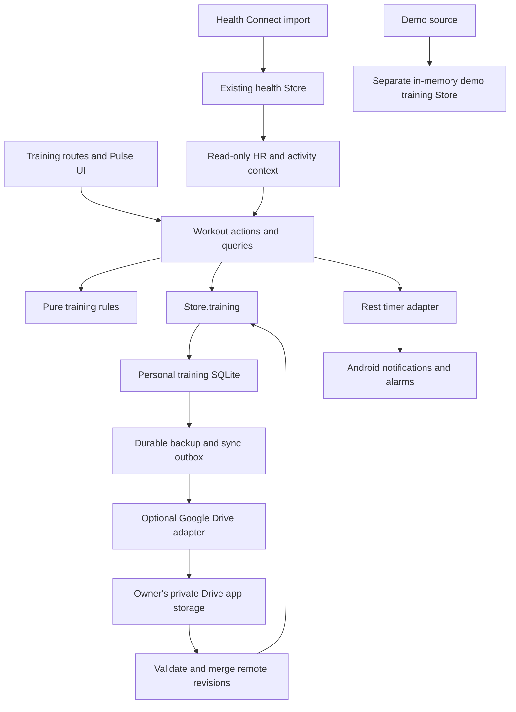
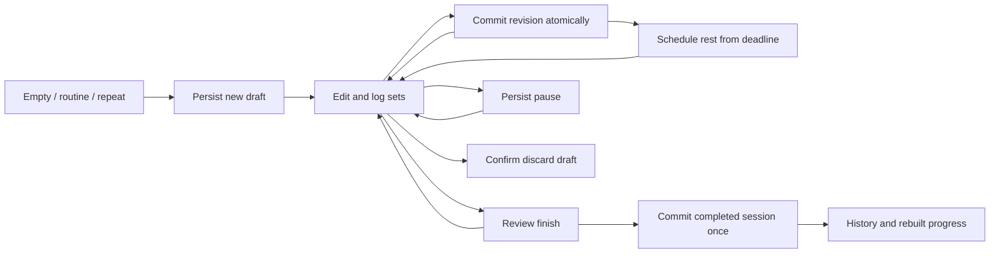

# Pulse workout tracker: implementation plan

Status: proposed, 29 October 2026; updated with the owner's Google Drive backup/sync suggestion. Research and planning only; no tracker implementation in this change.

Target: `yashsharan0805/pulse-mobile`, based on fork commit `dbda740e683030480cc3336823b257641e1482c6` (the widget preview app). This work is independent of the upstream widget PR. The [Hevy investigation](hevy-investigation.md) records the package identity, static findings, official sources and remaining unknowns.

## Product outcome

Make Pulse a complete personal gym log alongside its recovery, sleep, Strain and heart-rate features. A person can plan routines, record every set offline, recover an interrupted workout, review progress and move their history to another installation. Logging must work without a band, a Health Connect connection, an account or a server. Optional Google Drive authorization adds remote backups and device sync; local SQLite remains authoritative for saving a workout.

Use Hevy's documented logging workflow as a reference, with Pulse's own interface and implementation. Exercise descriptions, illustrations and catalog content must be original or have an explicitly recorded redistribution license. Do not copy the APK's code or assets into Pulse.

### Scope of the finished tracker

| Area | Required behavior |
|---|---|
| Workout entry | Start empty, start a routine, or repeat a previous workout; resume a draft from anywhere in Pulse. |
| Exercise library | Search and filter by name, muscle and equipment; favorites; original/licensed built-ins; custom exercises and aliases. Archive referenced exercises rather than breaking history. |
| Routines | Folders, ordered exercises, set targets and rep ranges, exercise notes, rest defaults and supersets. Duplicate/reorder/edit routines; optional local reminders. |
| Set logging | Load/reps, reps only, weighted or assisted bodyweight, duration, load + duration, distance + duration, distance + load, and optional steps/floors + duration. Fields depend on the exercise. |
| Workout editing | Add/remove/replace/reorder exercises, add/copy/delete sets with undo, notes, warm-up/normal/drop/failure types, optional RPE or RIR, separate planned and actual values. |
| Timers | Session start/pause/resume; per-exercise rest defaults; automatic rest after completion; add/subtract/skip rest; elapsed timers for timed sets. |
| Finish | Review incomplete sets, title, notes, dates and duration; save exactly once; explicitly choose whether to update the routine's targets/structure. |
| History | Calendar/list, session detail, edit/delete with undo, repeat, exercise-specific history, previous performance from any workout or the same routine. |
| Progress | Completed working sets, training frequency, comparable volume, muscle-set estimates, rep/load/duration/distance records and explicitly estimated 1RM where applicable. |
| Portability | Versioned lossless JSON backup/restore; human-readable CSV export; staged CSV import with mapping, units, preview and duplicate handling. Hevy export is an input format, not a required paid API integration. |
| Optional Drive | Versioned backups and restore first; then sync completed workouts, routines, custom exercises and training preferences between the owner's devices, including conflict and deletion handling. |
| Pulse context | Optional measured HR/zones and recovery context. Associate a local session with an imported activity without counting it twice. |
| Convenience | Persistent resume banner, large touch targets, accessible set completion, sensible keyboard flow, dark/light modes and quick-start/resume widgets. |

Social feeds, Pulse accounts, subscriptions, coaching marketplaces and a Wear OS companion are separate product projects. Google Drive is an optional user-owned storage provider, not a requirement for phone-local logging or a new Pulse backend.

## Why this needs a new training domain

Pulse currently has a live HR/Strain coach, not a strength log:

- `src/live/sessions.ts:34` stores session time, HR, zones and Strain, with a 50-record cap at line 13. It has no exercises or sets.
- `src/live/storage.ts:7` stores those summaries in AsyncStorage; line 28 suppresses write errors. This is unsuitable for authoritative gym history.
- `src/screens/workout/LiveWorkoutScreen.tsx` holds the active session in component state/refs and saves on unmount. Navigating away must not become “finish workout” in the new logger.
- `src/data/types.ts:54` describes imported activity envelopes. `Store.clearImported` in `src/data/store.ts:38` explicitly replaces imported workouts. A locally entered bench-press log must never become an imported activity row.
- `exploreSample` and `connectHealth` in `src/state/app.ts` call `store.clearAll()` while switching sources. Personal training history must survive those paths.
- Boot/onboarding currently expects a health source/profile; a manual training mode needs its own reachable entry path.

These are ownership and durability changes before they are UI changes.

## Storage and application boundaries

### Proposed decision

Create a dedicated `pulse-training.sqlite` database, implemented only inside `src/data/training/`. Expose it through a `Store.training` capability so screens/actions still use the repository's Store boundary. Add an in-memory equivalent for tests. Health import, rescoring and demo clearing never open or clear this database.

This extends the current Store contract; it does not allow screens or `src/core` to access SQLite. Resolve the required halo reference before implementing shared data/query changes. The configured `~/personal/halo` checkout was unavailable during this investigation; that is an implementation prerequisite, not evidence for copying an uninspected design.

Use schema versions and transactional migrations, foreign keys, WAL and bounded queries. Fail migrations without resetting the database. Keep a recoverable pre-migration backup for destructive schema transformations. Never silently overwrite an unreadable training store with an empty one.

Keep personal training in a distinct data source when viewing demo data. Existing health `clearAll()` must remain scoped to health storage. Add an explicit full-personal-data reset that closes/purges both stores and retries an interrupted reset using a durable reset marker. Source switching, reimporting and changing permissions are never full resets.

### Entities and invariants

| Entity | Essential fields and rules |
|---|---|
| Exercise definition | Stable ID, source/license, name/aliases, equipment, muscles, measurement kind, load and unilateral conventions, archived flag. Custom edits do not rewrite saved workouts. |
| Routine/folder | Stable IDs and order; routine revision; ordered exercise occurrences with notes, set targets, rep ranges, rest policy and superset membership. |
| Training session | Stable ID, title, status, revision, source routine/revision, start/end instants, original timezone, pause events, notes and session-level context. Exactly one active/paused draft in the first version. |
| Exercise occurrence | Its own stable ID and order, definition ID plus historical name/type snapshot, session notes, superset group, rest override and unit preferences. Repeated occurrences of one exercise are valid. |
| Set | Stable ID and order, measurement kind, nullable actual values, planned values separately, kind, completion/outcome, completion timestamp and optional effort. Reordering never changes identity. |
| Timer | Stable ID, owning session/set, deadline/start, duration and status, notification identifier and scheduling result. Deadline is authoritative; a JS interval only redraws the display. |
| Activity association | Local session ID, imported record ID/source, match status and provenance. A candidate time overlap is not proof of identity. |
| Derived results | Rebuildable summaries/records with rules version and input revision. Raw sets remain the source of truth. |

Store canonical kg, metres and seconds while retaining the entered unit and exercise conventions. Use a validated decimal representation/precision policy so repeated kg/lb edits do not drift. Store instants in milliseconds consistently; adapters convert external seconds explicitly. Preserve the session's original timezone for history; pause and rest durations must not depend on local midnight or DST.

Define semantics before calculating progress:

- Missing values are null, never inferred zero. An unchecked target is not a performed set.
- A failure-type working set and an unsuccessful zero-rep attempt are different. Allow an explicit failed attempt with zero reps and a note; exclude it from completed-rep volume and record awards.
- RPE and RIR are optional, validated effort inputs. Store the original scale; any conversion is labeled approximate. Failure is not automatically inferred from RPE.
- Assisted load is positive assistance, separate from added load. Capture bodyweight provenance/date when used; absent bodyweight means an unavailable bodyweight-based estimate.
- Specify per-hand versus total load, per-side versus total reps, and unilateral sets. Never silently double dumbbell volume.
- Separate warm-up inclusion settings for summaries and records. Estimated 1RM applies only to eligible successful sets and a documented, versioned formula/range. Do not promise numerical parity with Hevy.
- Muscle-set totals are estimates using a published attribution policy, not measured muscle stimulus. Do not add unlike exercise-volume measures into a misleading total.

## Logging behavior and UI

Add a Training destination to the existing navigation, with Routines, History and Exercises beneath it. Keep the current live coach reachable as HR/Strain coaching. The logger uses Pulse tokens, typography and surfaces, rather than recreating Hevy's visual assets.

The workout screen has an always-visible session header (duration, pause, finish), exercise cards, compact editable set rows and a rest bar. A row shows set type, previous performance, editable actual fields and a completion control. Previous values and planned targets have distinct labels; filling a target must not mark it completed. Show an optional HR strip only when measurements exist, including source and freshness. Band disconnection cannot prevent set logging.

Every acknowledged set completion and structural edit must be committed durably. Text input may show a pending-save state, but blur/background/finish flushes it and a write failure stays visible. Serialize mutations using session revision checks; a repeated tap cannot create duplicate sets or sessions. App termination may interrupt the last pending edit, but must not lose previously acknowledged edits. Restore the draft and timer deadline on boot.

Finishing is a single database transaction: validate the draft revision, retain only explicitly accepted performed data, snapshot the session, mark completion and record any requested routine update. Cancel obsolete timer notifications after commit, with reconciliation on next boot if that external action fails. Do not silently drop incomplete rows: the review offers “return to workout” or explicitly discard them. Preserve failed attempts as such.

Editing a saved workout is a separate revisioned editor with save/cancel; it must not seize the active workout. Deleting/editing invalidates derived results from that session's date onward. Routine edits affect future drafts, while saved session snapshots stay stable. Updating a routine after a session is an explicit choice with a visible diff; it never changes the actual set history.

## Android timer and notification strategy

Persist rest start/deadline and reconcile on foreground/boot. Support add/subtract/skip and supersets; rest policy is explicit for normal, warm-up and consecutive drop sets. Inline timed sets and session elapsed time are separate timers.

Before implementation, read the installed Expo SDK 57 versioned notification/background documentation and verify Android restrictions. Start with supported Expo scheduling. If measured behavior cannot meet the locked-screen timer requirement, add a minimal module/config plugin with a documented permission model; never hand-edit generated `android/`. Inspect existing `src/background/notify.ts` for reusable channel handling.

Notification denial and unavailable exact alarms must leave logging functional. Show the actual scheduling capability, provide an in-app timer, and avoid promising precise background alerts when Android can defer them. Reconcile stale notifications after finish, discard, force-stop/relaunch, reboot or a clock change. Native alarm delivery and process-death behavior require the owner's phone checks; static code does not validate them.

## Pulse integration without duplicate strain

Strength logging and health scoring remain separate. The existing `src/live/sessions.ts` comment deliberately waits for imported Fitbit activity so workouts count once. Preserve that contract: a local set log alone does not add imported exercise rows, calories or a fabricated Strain score. Set volume is not a calibrated cardiovascular or muscular Strain measurement.

Attach optional HR from an actually supported live sensor, or from imported samples covering the session, with gaps/freshness and source provenance. Do not assume every Fitbit can provide live BLE heart rate. Store a link to an existing coach session rather than merging its 50-item summary storage into the authoritative training log. Migrating old summaries preserves them as legacy coaching records with unknown set details; never synthesize exercises.

Show potential local/imported activity matches using time/type/source, require confirmation for ambiguity and retain the original health record. Read-only associations combine the display, not the scoring inputs. Source record deletion/reimport must not delete the workout; reconnect associations safely. Any future strength-based scoring is a separate engine design with scoring-version changes and golden tests.

## Optional Google Drive backup and device sync

This is a proposed extension requested by the fork owner, not a feature found in Hevy or already implemented in Pulse. The current `AGENTS.md` says no Google sign-in/no network source. The implementation PR must explicitly document the scoped exception for optional Drive authorization/storage; Health Connect remains the sole health-import source and keeps read-only permissions. A Google account is needed only to enable Drive, never to start a workout. No Pulse account/server is required.

### Provider and authorization

Use Drive's private `appDataFolder` with the narrow `drive.appdata` scope for managed backups/sync. Google documents that this space is app-only, hidden in the normal Drive UI and unavailable for sharing or trashing; deletions must be deliberate. Keep a separate manual export path for a user-visible backup. If that export is written directly to ordinary Drive, request the separate `drive.file` scope only for that feature. [App storage](https://developers.google.com/workspace/drive/api/guides/appdata), [scope definitions](https://developers.google.com/workspace/drive/api/guides/api-specific-auth).

For Android, evaluate Google's supported `AuthorizationClient` through an SDK-57-compatible native adapter/config plugin. The Google Cloud project needs Drive enabled, consent configuration and OAuth Android clients matching the actual application ID and signing certificates. Request authorization when the user selects “Connect Google Drive.” Obtain/re-obtain short-lived access through the native authorization API; do not embed a client secret or copy desktop OAuth/refresh-token flows into Android. [Android authorization guidance](https://developer.android.com/identity/authorization). Pin the implementation choice after reading current Expo documentation; no native dependency has been selected here.

Bind each local sync vault, outbox and cursor to the authorized Drive account and a random vault ID. Account switching must offer an explicit restore/new-vault choice; it must never upload the previous account's pending history to another account automatically. Disconnect removes authorization/cached credentials and pauses uploads while keeping local workouts. Deleting remote backups is a separate explicit action.

### First delivery: recoverable backups

1. Create a consistent, versioned logical export through `Store.training`, including referenced exercise snapshots, routines, preferences, deletion metadata and an optional active-draft snapshot. Do not copy a live SQLite main file while ignoring its WAL.
2. Write a new immutable backup with schema version, vault/device IDs, creation instant, content hash, record counts and a unique backup ID. Retain several successful generations. Upload retries must preserve the backup ID and tolerate an uncertain previous response.
3. Validate the uploaded artifact before reporting success. Show last successful backup, pending work and errors. A local Save succeeds independently of a network upload.
4. Restore into a temporary validated store, check schema/hash/counts, show a summary, preserve a rollback backup, then explicitly replace or merge the local training vault. Drive sign-in alone never authorizes overwriting local history.

Recommended cloud format: authenticated encryption using a reviewed implementation, with a device-keystore copy of the vault key and a user-held recovery secret for a new phone. A new install needs that recovery secret as well as Drive access; do not claim Google authorization alone restores an encrypted backup. Choose and test the recovery/key-wrapping design before encrypted backup is enabled. Tokens and recovery secrets never appear in logs or exported plaintext metadata.

These backups provide recovery on another phone. Automatic reconciliation of two independently edited histories is the next delivery, with its own tests.

### Second delivery: device sync protocol

**Proposed protocol:** synchronize logical revisions, never overwrite a shared live SQLite database or a single whole-history JSON file. Initially sync completed sessions, routines/folders, custom exercises and training preferences. An active draft is device-owned; live editing/handoff between two phones is deferred. Restoration of a draft from a backup is an explicit recovery action.

Each local mutation and its outbox record commit in one transaction. A revision has a stable operation ID, entity ID, device ID, per-device sequence and parent revision IDs. Use immutable remote revision files; a repeated upload may create duplicate Drive files, but applying the same operation ID is idempotent. Drive file names are not a uniqueness or locking mechanism.

For a workout, use the session aggregate as the merge/conflict unit initially; its sets retain stable IDs internally. Changes to different workout/routine entities can merge automatically. Divergent children of the same revision, including an edit concurrent with a deletion, retain both branches and show a conflict review. The user can compare/select a revision or keep a separate copy with a new ID. Never discard a session because one phone's clock is later. A user resolution references all conflicting parents.

Represent deletion as a tombstone revision so offline devices cannot resurrect removed workouts. Keep remote transport-file removal separate from a user deleting a workout. In the first protocol version, do not automatically garbage-collect revision/tombstone history; later compaction requires a tested checkpoint and device-acknowledgment/retirement policy. Full reset must offer local-only reset versus explicit deletion of the remote vault, otherwise a reconnect can restore what appeared deleted.

Bootstrap from a validated checkpoint plus revision files. Use the [Drive changes feed](https://developers.google.com/workspace/drive/api/guides/manage-changes) for later discovery; acquire the initial cursor before the initial scan so concurrent changes can be replayed. Apply changes idempotently, process every page and persist the cursor only after corresponding local transactions succeed. A missing/rejected checkpoint or cursor triggers a safe rescan, not an empty-history overwrite. A Drive change is a file event; Pulse still owns entity merge semantics.

Sync on app foreground, after a completed-workout edit/save and via “Sync now”; add best-effort Android background work after phone validation. Google Drive's [push mechanism](https://developers.google.com/workspace/drive/api/guides/push) requires an HTTPS webhook receiver, so the server-free design does not promise instant push sync. Use bounded retries/backoff for transient errors, visible quota/auth errors and resumable uploads where appropriate. [Uploads](https://developers.google.com/workspace/drive/api/guides/manage-uploads), [errors](https://developers.google.com/workspace/drive/api/guides/handle-errors).

### Data scope and release gate

The initial cloud scope is the training vault and its explicit session context. Raw Health Connect records, intraday HR streams, recovery/Strain score databases, chat history and unrelated profile data are excluded. On another phone, health permissions/imports remain device-local; external activity associations must be revalidated, not assumed portable. Any later backup of wider Pulse data needs its own data/schema/recovery design.

Release tests must cover two offline devices editing/deleting the same session, duplicate/uncertain uploads, out-of-order files, interrupted pagination, failed cursor commits, old-client schemas, account switches, token revocation, full Drive storage, encrypted-key recovery and remote data deletion. Unit/integration fixtures simulate these cases; the owner verifies actual authorization/restore on two installations. “Backed up” means a verified recovery artifact exists; “Synced” additionally means no pending operations or unresolved conflicts from the last successful reconciliation.

## Delivery sequence and acceptance gates

Each milestone is a small fork PR with its own demo-data screenshots. The finished scope above remains the target; the first slice proves durability before adding advanced UI.

| Milestone | Deliverable | Exit criteria |
|---|---|---|
| 0 — Contracts | Training data model, units/effort/record rules, manual-mode boot, source/reset boundaries, exercise licensing decision and schema design. Resolve halo reference. | Approved contracts and fixtures cover every measurement kind, source switch and ownership boundary. No health scoring behavior changes. |
| 1 — Reliable vertical slice | Manual entry path; small original exercise catalog + custom exercise; start empty → edit weight/reps → complete sets → review/save → history detail; draft resume. | Offline session survives process death; acknowledged sets survive; repeated Finish saves once; database errors are visible; no history cap. JSON backup/restore works before real use. |
| 2 — Gym workflow | Routines/folders, repeat, previous-vs-target values, all measurement kinds, notes, RPE/RIR, set types, reorder/replace/undo, supersets and timers. | A full mixed strength/timed session can be logged with one hand; routine changes do not rewrite history; timer denial/background paths checked on the phone. |
| 3 — Progress | Saved-session editing, calendar/history filters, exercise charts, records, versioned e1RM and muscle-set summaries. | Units/bodyweight/assistance/unilateral/warm-up rules pass fixtures; edits/deletes rebuild correct records; comparison views explain unavailable estimates. |
| 4 — Pulse context and portability | Optional live/imported HR, coach linking, activity association, CSV export and Hevy CSV import, robust backup/restore and explicit reset. | Reimport/demo switches preserve personal training; matching does not double score; import preview/duplicate handling and export/restore round trips pass. |
| 5a — Drive recovery | Optional authorization, versioned encrypted backups, status/retention and restore on a second installation. | Network failure never blocks logging; verified recovery, account isolation, revocation and recovery-secret tests pass. Can be delivered after milestone 1's backup format stabilizes. |
| 5b — Drive device sync | Durable outbox/inbox, revision protocol, changes-feed discovery, tombstones and conflict UI. | Two devices converge without silent data loss; offline edits/deletions, retries, account switches and interrupted sync pass the protocol matrix. |
| 6 — Release polish | Accessibility, localization, large histories, reminders, quick-start/resume widgets, owner phone checks and release docs. | TalkBack/font scaling, realistic long routines, cold start, locked screen and offline recovery pass; demo screenshots and reproducible validation accompany fork PRs. |

Suggested code placement: `src/core/training/` for pure validation/metrics/state transitions; `src/data/training/` for SQLite and memory storage; `src/actions/training/` for writes/timers; `src/queries/training/` for view models; `src/screens/training/` and root `app/` routes for UI. A scoped adapter in the existing Store/state composition owns the capability. Reuse `src/ui` and existing i18n conventions. Final module/API names are implementation decisions, not existing interfaces.

## Verification plan

Run the repository's typecheck, lint and Vitest suite for each implementation PR. Add meaningful domain/storage/action/query tests, not tests that mirror component markup. Include these failure cases:

1. Crash before/after a transaction, low disk space, rejected writes, double completion/finish taps, stale revisions and save retry.
2. Process restart with an active or paused session; navigation/unmount never auto-finishes. Recover the latest committed set order/notes/timer.
3. Reordering/removing/replacing exercises in a superset, undo and duplicate exercise occurrences retain stable references.
4. kg/lb round trips, locale decimal input, nullable fields, assisted/bodyweight/unilateral conventions, failed zero-rep attempts and every typed set.
5. Finish with incomplete sets, cancel review, optional routine updates and editing old history while a draft exists.
6. Health reimport, source permission revocation, demo entry/exit and profile edits preserve training. Explicit full reset removes both stores and resumes after interruption.
7. Migration rollback, lossless backup/restore, malformed/partial files, duplicate imports, unknown exercise mapping, CSV timezone/unit conversions and very large histories.
8. Records/e1RM rebuild after historical edit/delete; no future workout leaks into a previous-performance or historical-record query.
9. Drive backup/restore and two-device convergence, divergent revisions, tombstones, duplicate uploads, cursor replay, account isolation and recovery-key handling as specified above.

The owner manually checks Android notification permission denial, exact-alarm availability, locked-screen delivery, reboot, force-stop/relaunch, clock changes, BLE disconnection, keyboard/TalkBack/font scaling and widget links. Follow the repo's prohibition on local e2e/device automation. CI plus the owner's phone evidence gates a release; a green Node test suite does not prove Android alarm delivery.

## Review decisions

Recommended defaults: offline/manual logging available immediately; one active draft; dedicated training database behind Store; explicit routine updates; previous values from any workout with a same-routine setting; kg/lb preference per exercise; working-set volume separate from warm-ups; optional RPE with RIR available as an alternative; no automatic new Strain calculation. Add optional Drive recovery first and conflict-aware device sync next, with no Pulse server or mandatory account. These can be reviewed before milestone 0 implementation.

No workout-tracker source, app build or APK is part of this planning change. The research answers the logging/data-flow questions sufficiently to design the tracker; Hevy runtime reliability, complete server behavior and proprietary algorithms remain unverified.
